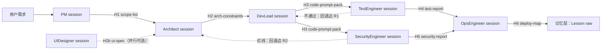

# 02 — 会话交接契约（Agent 编排总线核心）

> **文档级别**：四期契约  
> **日期**：2026-07-29  
> **原则**：交接 = 「交付物文件 + 信封消息」；机器 SoT = 本地 Markdown（`deliverable.path`，供校验/H3）；人对人展示 SoT = 飞书云文档（形态 A 双写，见 main SOUL「文档类交付双写」）；信封是会话间唯一通信格式  
> **角色定义**：本仓 `docs/zh/agents/standard/**`；门禁：[`stage-gate-flow`](../../Code/code/docs/zh/skills/custom/common/stage-gate-flow/index.md)

---

## 1. 为什么要有契约

现状：角色间靠人手动 `@` 说明书接力，上下文靠对话记忆搬运——断链、漏交付物、门禁全凭自觉。编排总线后，**每一跳的输入/输出必须机器可校验**，否则自动化只会更快地制造混乱。契约管三件事：

1. 每跳**产出什么**（交付物 + 必备章节）
2. 每跳**怎么算完**（出门门禁 + 证据分层）
3. 跳与跳之间**传什么**（交接信封 schema）

## 2. 交接信封（handoff envelope）

每一跳完成时，生产者 session 向编排者（OpenClaw 主调度）提交一个信封；编排者据此唤起下一跳 session。**信封是消息，交付物是文件**——信封只带路径与摘要，不内嵌长文。

```yaml
handoff:
  from: ProductManager            # 生产者角色 id（本仓 agents id）
  to: Architect                   # 消费者角色 id；并行时为列表
  project: <project-id>           # 对应 operations/<project-id> 与业务仓
  stage: requirements             # requirements|design|develop|test|security|release
  deliverable:
    kind: scope-list              # 见 §3 各跳 kind
    path: doc/iterations/<proj>/AI代码生成范围清单_xxx.md   # 本地镜像路径（必填，须真实存在）
    # feishu_url: https://...     # 可选；形态 A 文档类双写后由编排者填入 summary 或同级字段
    summary: |                    # 三行内：范围、显式不做、验收口径（可附飞书链接）
  decisions: []                   # 已定决策——下游不可静默推翻，只能走回退边
  open_questions: []              # 留给下游的问题；为空表示无悬置
  gate:
    checklist: stage-gate-flow    # 出门清单引用（本仓技能 id）
    evidence: <证据路径，或「部分证据：…」标注>   # 证据分层纪律见 deploy-verify
  lesson_hint: ""                 # 可选：本跳踩坑一句话 → 唤起方提示记 Lesson
```

校验：必填 `from/to/project/stage/deliverable.kind/deliverable.path`；`deliverable.path` 必须真实存在（编排者检查）；kind 必须是 §3 枚举之一。

## 3. 六跳契约（主链路）



| 跳 | 生产者 → 消费者 | deliverable.kind | 交付物必备章节 | 出门门禁（摘要） |
|----|----------------|------------------|----------------|------------------|
| H1 | ProductManager → Architect | `scope-list` | 《AI代码生成范围清单》：目标 / 范围条目 / **显式不做** / 验收口径 / 约束引用 | 范围条目均可验收；「不做」非空或显式声明无 |
| H2 | Architect → DevLead | `arch-constraints` | 《架构约束与接口》：分层 / 接口数据模型 / 技术选型与理由 / 红色模块清单 / 与 L0 对照 | 接口模型字段级；红色模块有判定理由 |
| H2b | UIDesigner → DevLead（并行可选） | `ui-spec` | 页面结构 / 交互态 / 设计 token 或约束 | 与 H2 接口模型不冲突 |
| H3 | DevLead → TestEngineer、SecurityEngineer（并行） | `code-prompt-pack` | AI Prompt 存档 / 代码产出位置 / 《核心模块AI生成红色记录》/ CR 记录 | prompt-versioning 归档；红色记录可追溯 |
| H4 | TestEngineer → OpsEngineer | `test-report` | 《AI代码测试报告》：用例 / 结果 / 缺陷分级 / 未覆盖声明 | 关键路径全测；未覆盖项显式列出 |
| H5 | SecurityEngineer → OpsEngineer | `security-report` | 《AI代码安全报告》：威胁面 / 扫描与人工发现 / 红线结论 | 红线结论非空；含密钥扫描 |
| H6 | OpsEngineer → 记忆层 | `deploy-map` | 部署记录 + 版本映射（commit ↔ 环境） | 证据分层（MCP health ≠ Host 探测）；Lesson raw 落盘或「本阶段无新教训」 |

真实交付物样例（外部仓，格式对齐用）：`MechAssist-Fusion/doc/remote-agent-openclaw/bm/v*/AI代码生成范围清单_*`、`架构约束与接口_*`、`核心模块AI生成红色记录_*`、`V*_验收记录.md`。

## 4. 回退边（失败不算完，算路由）

| 边 | 触发 | 动作 |
|----|------|------|
| R1 | H4 测试不通过 / H3 自检失败 | 信封回 DevLead，`open_questions` 带失败清单；**不允许** TestEngineer 改代码 |
| R2 | H5 安全红线（硬编码密钥、鉴权绕过等 L0 级） | 信封回 Architect（设计缺陷）或 DevLead（实现缺陷），`decisions` 标注被推翻项 |
| R3 | 任何一跳交付物校验失败（缺章节 / 路径不存在） | 编排者拒收信封，生产者补全重交；同一跳连续 2 次拒收 → 人工接管 |

## 5. 人工接管点（人在回路）

| 点 | 位置 | 人工动作 |
|----|------|----------|
| M1 | H1 之前 | 确认需求值得进流水线（防止垃圾进、垃圾出） |
| M2 | H2 之后 | 架构评审签字（顶级模型产出≠免审） |
| M3 | H6 之前 | 部署放行——必须是人按 deploy-verify 证据分层勾选 |
| M4 | R3 触发时 | 接管该跳，事后记 Lesson（`lesson_hint` 必填） |

## 6. 与记忆层的闭环

H6 是流水线出口也是记忆入口：部署完成 → 按触发句写 Lesson raw（`scope` 初判）→ 周末/收尾跑 `npm run lessons:scan` → 跨项目重复项终审升格 → skill 正文变好 → 下一次 H1～H6 的说明书质量提升。编排总线越快，这个循环越必须有门禁，否则错误也会被复用。
