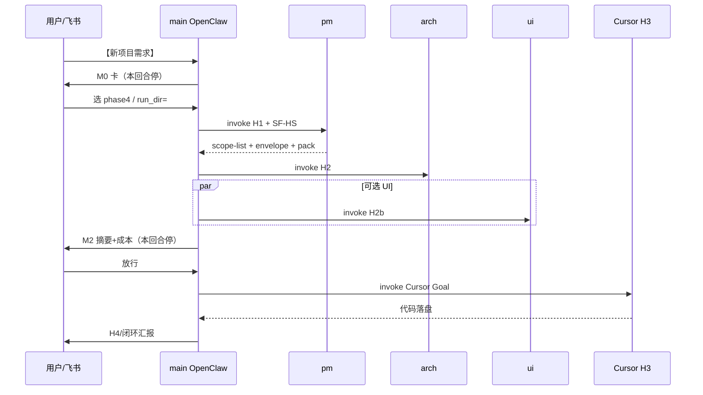

# 10 — 编排流水现网实现流程 + 优化点清单

> **文档级别**：四期运维 / 优化设计  
> **日期**：2026-08-04  
> **机器**：bm（证据来自本机 OpenClaw + Site 仓）  
> **Demo 真源**：[`../../Code/doc/phase4/run-ai-vg-web-ui-route1-20260803/`](../../Code/doc/phase4/run-ai-vg-web-ui-route1-20260803/)  
> **相关契约**：[`02`](02-orchestration-contracts.md) · [`06` SF-HS](06-single-facade-hop-snapshot.md) · [`07` M0](07-run-dir-m0-card.md) · [`08` 成本](08-cost-ledger-schema.md) · SOUL 草稿 `Code/orchestration/prompts/orchestrator-main-soul.draft.md`

**读法**：§1–§2 = 现状怎么跑；§3 = Demo 数据；§4 = **上下文内存分层**；§5–§7 = 提升点；§8 = **执行计划**；§9 = 复核模板。  
数字带「预估」的不是承诺 KPI，落地后用下一轮 `cost-ledger.yaml` + 墙钟对照本表复核。

---

## 1. 一句话现状

```text
飞书【新项目需求】
  → main（OpenClaw）M0 选 run-dir
  → H1 pm → H2 arch [∥ H2b ui]
  → M2 人签字停
  →（放行）H3 Cursor 写码 → H4 复验
```

- **大脑**：本机 OpenClaw Gateway + 命名 agent（pm/arch/ui…）+ `agents-skill-remote` MCP  
- **手脚**：本机 Cursor Agent CLI（H3）  
- **痕迹**：M0 选定的 `run-dir`（默认 `Code/doc/phase4/run-<短名>-<日期>/`）  
- **人不进代码跳**：M2 未放行前禁止 H3  

---

## 2. 端到端实现流程（按脚本/产物）

### 2.1 参与组件

| 层 | 路径 / 配置 | 作用 |
|----|-------------|------|
| 编排人格 | `~/.openclaw/workspace/SOUL.md`（草稿：`orchestrator-main-soul.draft.md`） | main 路由、门禁、防空转、升格 |
| 花名册 | `~/.openclaw/openclaw.json` · `setup-agents.ps1` | pm=pro / arch=pro / ui…=flash |
| MCP | `agents-skill-remote`（公网只读） | SF-HS：health → get_agent/skill → get_source_text |
| 派遣 | `invoke-openclaw-agent.cjs` | 绕开 PS5.1 argv；可选 `--cost-ledger` |
| M0 | `build-run-dir-card.cjs` + `resolve-run-dir.cjs` + `run-dir-presets.yaml` | 飞书卡选痕迹目录 |
| 成本 | `openclaw/cost/*.cjs` + `pricing.yaml` | 每跳 usage → `cost-ledger.yaml` |
| 出图（可选） | `openclaw/ui-image/generate-ui-image.cjs` | 路线1：H2b 写 JSON，main 调 ARK |
| H3 | MechAssist `invoke-cursor-agent.ps1`（SOUL 引用） | Goal 文件 + TimeoutSec |

### 2.2 跳序与门禁



| 阶段 | 谁 | 输入 | 输出（落盘约定） | 停止条件 |
|------|-----|------|------------------|----------|
| **M0** | main | 需求短名 | 交互卡；确认后 `runDir` | **本回合停** |
| **H1** | pm | `h1.message.md` | `h1-*.md` / `handoff-h1.envelope.yaml` / `mcp-resolve-h1.yaml` / `playbook-pack-h1.md` | 信封四要素 + Pack 非空 |
| **H2** | arch | 上跳信封 + 范围清单 | arch 交付物 + envelope + Pack | 同上 |
| **H2b** | ui | H1（+H2 若已有） | UI 规范 + envelope；路线1 另写 `ui-image-request.json` | 无图可不挡 |
| **双写** | main | 本地 md | 飞书云文档链接 | create 须 folder_token |
| **M2** | 人 | 摘要 | 「放行」 | **本回合停**，禁开 H3 |
| **H3** | Cursor | `h3-goal.md`（灌 Pack 快照） | 业务仓代码 + raw | TimeoutSec；僵死即停 |
| **H4** | main/人 | 代码 | 复验记录 | 系统 node 复验（勿用 agent 内 node） |

### 2.3 单跳内部（文档跳 SF-HS）

对 **pm / arch / ui** 每一跳，消息稿要求：

1. `health` → `get_agent` → `get_skill`(1–N) → **`get_source_text`**（全文）  
2. 落盘 `mcp-resolve-hN.yaml`（无 token）+ `playbook-pack-hN.md`  
3. 写交付物全文 → stdout（或 raw）中 `---`SPLIT`---` → handoff YAML  
4. main：校验 →（文档类）`feishu_doc` 双写 → `append-cost-hop`  

**禁止**：子 agent 调飞书；用本机 Site 路径替代 MCP 正文主路径。

### 2.4 路线1 出图（可选支路）

```text
H2b → ui-image-request.json（无 Key）
  → main: generate-ui-image.cjs（Key 仅 ~/.openclaw/.env）
  → PNG → 规范 §0 image_path
  → H3 Goal 带规范路径 + 图路径
```

---

## 3. Demo：`run-ai-vg-web-ui-route1-20260803`

> 需求：AI Virtual Glasses Web/UI 调试控制台（路线1：脚本出图）  
> 短名：`ai-vg-web-ui-route1`  
> run-dir：`Code/doc/phase4/run-ai-vg-web-ui-route1-20260803/`

### 3.1 时间与跳数（台账）

摘自同目录 `cost-ledger.yaml`：

| 字段 | 值 |
|------|-----|
| `created_at` → `updated_at` | `2026-08-03T05:54Z` → `07:34Z` ≈ **~100 min** 墙钟 |
| `hop_count` | **4**（H1 / H2 / H2b / H3） |
| `tokens_total` | **1,415,669** |
| `tokens_input` / `output` / `cached_input` | 161,913 / 58,620 / **1,195,136** |
| 模型 | H1/H2：`deepseek-v4-pro`；H2b：`deepseek-v4-flash`；H3：`cursor/agent` |

### 3.2 每跳 tokens（Demo）

| Hop | role | model | tokens.total | 备注 |
|:---:|------|--------|-------------:|------|
| H1 | pm | v4-pro | 438,286 | trajectory **4** 个 session |
| H2 | arch | v4-pro | 449,040 | trajectory **4** 个 session |
| H2b | ui | v4-flash | 528,343 | 交付物最大 |
| H3 | cursor | subscription | 0（未计入 token） | 曾出现 ~30min 僵死 poll |

### 3.3 产物体积（Demo，约）

| 文件 | 约大小 | 说明 |
|------|-------:|------|
| `h1.message.md` | 3.4 KB | 消息稿 |
| `h2.message.md` | 5.6 KB | 内嵌上跳信封，偏重 |
| `h2b.message.md` | 4.2 KB | |
| `h1-scope-list` 类交付 | ~13 KB | |
| `h2b-ui.deliverable.md` | **~42 KB** | UI 规范全文 |
| `h2b-ui.raw.txt` | **0 B** | stdout 空；靠落盘抢救（已知 Lesson） |
| `h3-goal.md` | ~11 KB | 灌 Pack / 规范路径 |
| `playbook-pack-h1/h2/h2b` | 4–7 KB | SF-HS 快照 |
| 目录合计 | ~130 KB | 不含业务仓 `web/` 代码 |

### 3.4 目录骨架（Demo）

```text
run-ai-vg-web-ui-route1-20260803/
  h1.message.md / h1-*.md / handoff-h1.envelope.yaml
  mcp-resolve-h1.yaml / playbook-pack-h1.md
  h2.message.md / h2-*.md / handoff-h2.envelope.yaml / …
  h2b.message.md / h2b-ui.deliverable.md / handoff-h2b.envelope.yaml / …
  ui-image-request.json
  h3-goal.md / h3-run-wrapper.ps1
  cost-ledger.yaml / cursor-usage.json
```

### 3.5 瓶颈归因（对照 Demo）

| 现象 | 主因 |
|------|------|
| cached_input ≈ 总 token 的 84% | 多 session 轨迹叠加 + 每跳 MCP 全文 |
| H2b 最重 | UIDesigner / frontend-design / doc-coauthoring 全文 + 大规范 |
| 墙钟 ~100min | 串行跳 + 飞书双写 + **H3 空等** |
| raw 0 字节 | CLI stdout 空信封问题（已有 wrapper/Lesson，未根治流程侧） |

---

## 4. 上下文内存分层（指针 / 热小 / 冷大）

> 类比编程：**指针**指地址；**普通访存**拿小热数据；**DMA** 搬大块连续外存。  
> AI 工作流同理：**对话不搬仓库，只传句柄；大块落盘，模型按需 read，回灌只要关键摘要。**

### 4.1 分层定义

| 层级 | 类比 | 驻留哪里 | 体积纪律 | 典型内容 |
|:----:|------|----------|----------|----------|
| **L0 热** | 寄存器 / 直接地址访问 | 当前 prompt、tool 短结果、最终回复 | **宜 &lt; 2～4 KB/段**；禁整文档 | 任务一句、硬禁区 5～15 条、open_questions、验收要点、`ok/fail` |
| **L0.5 指针** | 指针 / 句柄 | 信封 YAML、消息稿、Goal 头 | 路径 + hash + kind；**无正文** | `run_dir`、`deliverable.path`、`contentHash`、`playbook-pack-hN.md`、`image_path` |
| **L1 冷（DMA）** | 大块外存 / DMA | 磁盘 run-dir、业务仓、MCP 源正文 | **不进对话常驻**；按需 `read` / `get_source_text` | `*.deliverable.md`、技能全文、源码树、PNG、飞书云文档镜像 |

```text
L0.5 指针 ──► L1 DMA（read 大块）──► 抽出 L0 热摘要 ──► 写入下一跳指针
                 ▲                         │
                 └──── 用完不必整段回灌 ─────┘
```

### 4.2 与现网组件的映射

| 组件 | 当前偏向 | 目标分层 |
|------|----------|----------|
| handoff envelope | 已有 path（指针） | **L0.5** 为主；summary 保持短 |
| `playbook-pack-hN.md` | 偏 L1 摘录 | 保留为 **L1**；Goal 只嵌 **L0 硬禁区** + Pack **路径** |
| agent 最终回复 | 常把 L1 全文当 stdout（反模式） | 回复 = **L0.5 + 短 L0**；正文只写 L1 文件 |
| H2 消息稿粘贴 H1 YAML | L1 误进热路径 | 改为 **L0.5**（`prev_envelope_path` + hash） |
| SF-HS `get_source_text` | 每跳 DMA 全量 | 允许 hash 命中则 **跳过 DMA**，复用已有 Pack |
| H3 `h3-goal.md` | 已有路径灌包 | **L0 摘要 + L0.5 必读列表**；规格全文 Cursor 自己 DMA |
| main SOUL | 全量常驻偏热 | 拆成 L0 短路由 + L1 附录（触发再 read） |
| 飞书双写 | 给人看的 L1 镜像 | 不占用模型上下文；链接进 L0.5 |

### 4.3 硬规则（落地后写进 SOUL / `02`）

1. **对话默认只传 L0 + L0.5**；出现整节交付物正文 = 违规（除非用户显式要贴）。  
2. **L1 唯一真源 = 磁盘路径**（机器 SoT）；飞书是人对人镜像。  
3. **H3 不依赖 OpenClaw 会话历史**；只依赖 Goal（L0/L0.5）+ 自行 read L1。  
4. **从 L1 回写上下文时只允许摘要**：标题、决策 3～7 条、风险、路径——禁止原文粘贴。  
5. **大小阈值（建议）**：单段将进 prompt 的文本 &gt; **8 KB** → 必须改指针 + read，不得整段嵌入消息稿。

### 4.4 反模式 ↔ 正模式

| 反模式（大块当寄存器） | 正模式（指针 + DMA） |
|------------------------|----------------------|
| H2 message 内嵌完整 H1 YAML | `prev: path + hash`，arch `read` |
| ui 最终回复 40KB 规范全文 | 写 `h2b-ui.deliverable.md`，回复只给 envelope |
| Goal 粘贴整份 UI 规范 | Goal 列路径 + 硬禁区 10 行 |
| 每跳强制 MCP 全文 | hash 未变 → 复用 Pack（P2-2） |
| main 为等 H3 反复长思考 | poll 短状态（L0），超时即停 |

### 4.5 和【提升】项的对应

| 分层目标 | 主要靠哪些提升 |
|----------|----------------|
| 对话变瘦（L0/L0.5） | P1-1、P1-3、P2-1 |
| DMA 少做 / 做完不回灌 | P0-2、P2-2 |
| H3 开发不受损 | §4.3 规则 3 + Goal 必读列表（见 §8 Phase B） |
| 墙钟 | P0-1、P1-2（与分层正交，可并行） |

---

## 5. 与「只 /new」的关系

`/new` 只清**当前聊天**上下文，**不能**：

- 缩短子 agent 每跳 MCP 全文  
- 去掉 H3 僵死等待  
- 减少 SOUL 常驻体积  
- 合并飞书双写等待  
- 把 L1 误塞进 L0 的契约改掉  

优化必须改：**契约 / SOUL / 消息模板 / 脚本 / 模型分档 / 超时纪律**（即落实 §4 分层）。

---

## 6. 提升点清单（特别标识）

图例：

- **【提升】** 建议项  
- **预估** = 相对 Demo（~100min / ~1.4M tokens）的量级，落地后复核  
- **改动面** = 要碰的文件/配置  

---

### 【提升】P0-1 · H3 硬超时 + 僵死即停/续跑

| 项 | 内容 |
|----|------|
| **问题** | Cursor `-TimeoutSec 1200`；poll 无增量仍空等 ~30min（Lesson `2026-08-03-ai-vg-web-ui-h3-stale-process`） |
| **预估墙钟** | **−20～40 min / 次**（砍掉空等；有代码则直接 H4） |
| **预估上下文** | 主会话少烧 poll 轮次（中） |
| **改动什么** | ① 线上 `SOUL.md` + 草稿：TimeoutSec→**300–480**；连续 2 次无增量即上报并停 ② `h3-run-wrapper` 模板默认超时 ③ 可选：wrapper 检测业务仓文件 mtime 变化则标记「可续 H4」 |
| **验收** | 再跑一跳：卡住不超过新超时；用户说「跳过」立即 H4 |

---

### 【提升】P0-2 · 每跳强制新 isolated session

| 项 | 内容 |
|----|------|
| **问题** | Demo H1/H2 各挂 **4** 个 trajectory → cached 膨胀 |
| **预估 token** | cached **−40～70%**（文档跳）；总 token **−30～50%** 量级 |
| **预估墙钟** | **−5～15 min**（少工具环/少重读） |
| **改动什么** | ① `invoke-openclaw-agent.cjs` 默认加「新 session」类 flag（以 OpenClaw CLI 实测为准，如 `--session`/`isolated`） ② SOUL：禁止同 role 续旧会话跑新 hop ③ 台账 `notes` 记录 session_id 唯一性 |
| **验收** | 新 run 的每 hop `source.paths` **≤1** 条 trajectory |

---

### 【提升】P1-1 · 交付物只落盘，stdout 只回信封

| 项 | 内容 |
|----|------|
| **问题** | 契约要求交付物全文进 agent 最终回复；H2b ~42KB 灌会话 |
| **预估 token** | 文档跳 output/上下文 **−20～40%**；拆包更稳（对齐 raw=0 时的落盘抢救） |
| **预估墙钟** | **−3～8 min**（少生成/少传大段） |
| **改动什么** | ① `02` / SOUL / `h*.message` 模板：最终回复 = 路径 + envelope YAML；正文必须已写入 `*.deliverable.md` ② main 校验改「读文件」而非「解析 stdout 全文」 ③ `role-session.md` 同步 |
| **风险** | 须防「声称已写盘但文件空」——校验文件 size>0 + 含标题 |

---

### 【提升】P1-2 · H2 ∥ H2b 真并行 + 飞书双写挪到 M2

| 项 | 内容 |
|----|------|
| **问题** | 契约写并行，现网常串行；每跳双写阻塞 |
| **预估墙钟** | **−10～25 min**（UI 与 arch 重叠；少 1～2 次飞书往返穿插） |
| **预估 token** | 近似不变（并行不省 token） |
| **改动什么** | ① SOUL：H2 与 H2b **同时** `invoke`，汇合后再 M2 ② 双写：H1/H2/H2b 本地齐了再一次性 `feishu_doc` ③ 消息稿去掉「等 H2 完成再开 H2b」硬依赖（保留「待 arch 复核」标注即可） |
| **验收** | 日志显示两 invoke 重叠；M2 前才出现飞书链接 |

---

### 【提升】P1-3 · 消息稿增量引用（不粘贴上跳全文）

| 项 | 内容 |
|----|------|
| **问题** | H2 message 粘贴完整 H1 YAML，链式变重 |
| **预估 token** | 后续跳输入 **−10～25%** |
| **预估墙钟** | **−2～5 min** |
| **改动什么** | ① 消息稿模板：`prev_envelope_path` + `contentHash` ② 子 agent 用 `read` 打开路径 ③ main 在写 message 时只写指针 |
| **验收** | `h2.message.md` 体积接近 H1 message，不再随上跳膨胀 |

---

### 【提升】P2-1 · SOUL 拆模式附录

| 项 | 内容 |
|----|------|
| **问题** | 常驻 SOUL ~18KB：流水线+升格+成本细则全在 |
| **预估 token** | **main 每轮 −30～50% 系统提示**（仅日常编排时） |
| **预估墙钟** | main 回合略快（次要） |
| **改动什么** | ① 常驻：短路由+硬禁区 ② `SOUL-promote.md` / `SOUL-cost.md` 触发句再 read ③ 部署清单写明同步顺序 |
| **风险** | 忘同步附录会导致「同意升格」失效——部署检查表打勾 |

---

### 【提升】P2-2 · SF-HS hash 命中跳过 get_source_text

| 项 | 内容 |
|----|------|
| **问题** | 每跳强制拉 agent/skill **全文**（UI 系最重） |
| **预估 token** | 文档跳 **−20～40%**（重复项目连跑时更高） |
| **预估墙钟** | **−5～12 min**（少 MCP 往返+少读） |
| **改动什么** | ① `06` 契约：允许「hash 未变 → 复用上跳 Pack 片段」 ② 消息稿分支逻辑 ③ 可选 MCP 侧增 `get_meta`（若公网 MCP 未提供则先本地缓存 hash） |
| **验收** | 同日第二需求：mcp-resolve 显示 `cache_hit: true` 且无全文 toolResult |

---

### 【提升】P2-3 · 文档跳默认 flash，签字前可选 pro

| 项 | 内容 |
|----|------|
| **问题** | Demo H1/H2 用 v4-pro，延迟与费用高于 flash |
| **预估墙钟** | H1+H2 **−20～40%** 跳内时间（模型相关，波动大） |
| **预估费用** | DeepSeek 文档跳明显下降（按官方价） |
| **改动什么** | ① `openclaw.json` / `agents.example.yaml`：pm/arch 默认 flash ② SOUL：M2 前可选「升格复核」再跑 pro ③ `03` 路由表改分档说明 |
| **风险** | 架构质量可能波动——仅对「熟模板需求」默认 flash |

---

### 【提升】P2-4 · 快轨路由（小需求跳跳）

| 项 | 内容 |
|----|------|
| **问题** | 任何【新项目需求】都走满链 |
| **预估墙钟** | 小改 **−50～70%**（跳过 H2b/双写/甚至 H2） |
| **预估 token** | 同量级下降 |
| **改动什么** | ① SOUL 增加 `【快轨】` / 自动判定（无 UI、单文件） ② `02` 增加快轨表 ③ M0 卡可选「快轨」按钮（扩展） |
| **验收** | 飞书一条快轨需求 ≤ H1+H3+H4 |

---

### 【提升】P2-5 · 出图移出关键路径

| 项 | 内容 |
|----|------|
| **问题** | 路线1 出图穿插在 H2b→M2 之间，失败/慢会拖签字 |
| **预估墙钟** | 含出图需求 **−3～10 min** 到 M2（出图改异步） |
| **改动什么** | SOUL + 眼镜仓 pipeline 文：M2 可无图签字；放行后或 H3 前再跑 `generate-ui-image.cjs` |
| **验收** | 无 ARK 时仍能 M2；有图再补 §0 |

---

## 7. 汇总表（优先序）

| ID | 提升点 | 预估墙钟 | 预估 token/上下文 | 改动面 | 优先级 | 分层 |
|----|--------|----------|-------------------|--------|:------:|:----:|
| P0-1 | H3 超时+僵死停 | −20～40 min | 中 | SOUL / h3 wrapper | **P0** | 正交 |
| P0-2 | 每跳新 session | −5～15 min | cached −40～70% | invoke + SOUL | **P0** | 减误缓存 |
| P1-1 | 落盘正文 / stdout 信封 | −3～8 min | 文档跳 −20～40% | 02 / 消息模板 / main 校验 | P1 | **L1←DMA** |
| P1-2 | H2∥H2b + 双写并到 M2 | −10～25 min | ≈0 | SOUL | P1 | 正交 |
| P1-3 | 消息增量引用 | −2～5 min | −10～25% | 消息模板 | P1 | **L0.5** |
| P2-1 | SOUL 拆附录 | 次要 | main 系统提示 −30～50% | SOUL 部署 | P2 | L0/L1 |
| P2-2 | SF-HS hash 跳过全文 | −5～12 min | −20～40% | 06 + 消息 + 可选 MCP | P2 | 少 DMA |
| P2-3 | 文档跳 flash | H1+H2 跳内 −20～40% | 费用↓ | openclaw.json | P2 | 正交 |
| P2-4 | 快轨 | 小改 −50～70% | 同降 | SOUL + 02 | P2 | 少跳 |
| P2-5 | 出图异步 | 到 M2 −3～10 min | 小 | SOUL + 业务 pipeline | P2 | L1 异步 |

**若只做 P0-1 + P0-2 + P1-2**：相对本 Demo，墙钟有机会从 ~100min 落到 **~40–60min** 量级（仍取决于 H3 真实编码时间）。  
**若再加 P1-1 + P1-3**：上下文接近 §4 目标形态，H3 仍靠指针读 L1，开发规格不砍。

---

## 8. 执行计划（bm · `feature/bm`）

> **原则**：先守 H3 输入（Goal 指针 + L1 落盘），再瘦中间对话；每 Phase 结束用 §9 模板对照基线 §3。  
> **分支**：只在 `feature/bm` 改；合入 `develop` 后再让 Home `pull`；勿改 `feature/home`。  
> **OpenClaw**：改草稿后必须同步 `~/.openclaw/workspace/SOUL.md` 才对飞书生效。

### Phase A — 墙钟止血（P0，约 0.5～1 天）

| 步 | 动作 | 产出 | 完成标准 |
|:--:|------|------|----------|
| A1 | SOUL 草稿：H3 `TimeoutSec`→300～480；poll 连续 2 次无增量即停并允许「跳过→H4」 | `orchestrator-main-soul.draft.md` | 文案含明确秒数与停法 |
| A2 | 同步线上 `SOUL.md`（备份 `.bak-opt-YYYYMMDD`） | 本机 SOUL | 飞书 `/status` 或抽查段落存在 |
| A3 | `invoke-openclaw-agent.cjs`：每 hop 新 isolated session（CLI 旗标以实测为准） | 脚本 + 简短注释 | 烟测 1 跳：`source.paths` 长度 = 1 |
| A4 | 小需求烟测（可无 UI）：M0→H1→M2→短 H3 | `Code/doc/phase4/bm/run-opt-p0-<日期>/` | H3 空等 &lt; 新超时；台账入库 |

**Phase A 不做**：改交付物契约、改 MCP、改 Home。

### Phase B — 指针 + DMA 落地（P1-1 / P1-3）**【分层核心 · 2026-08-04 bm 已落地契约/SOUL/模板】**

| 步 | 动作 | 产出 | 状态 |
|:--:|------|------|:----:|
| B1 | `02` §1.1 上下文内存分层 | `Doc/phase4/02` | ✅ |
| B2 | 消息稿义务 + `role-session.md` | `templates/hop.message.tier.md` · `role-session.md` · SOUL v1.6 | ✅ |
| B3 | main 校验：磁盘 size&gt;0；raw 空可收 | 线上 SOUL（备份 `.bak-tier-20260804`） | ✅ |
| B4 | 上跳指针模板 | `hop.message.tier.md` | ✅ |
| B5 | H3 Goal 壳 | `templates/h3.goal.tier.md` + sf-hs 块说明 | ✅ |
| B6 | 结构烟测 | `Code/doc/phase4/bm/run-opt-tier-20260804/` + `smoke-report.json` **pass** | ✅ 结构 |
| B7 | （待）飞书真跑一条含 UI 需求，对照 §3 基线 token/墙钟 | 下一次【新项目需求】 | ⏳ |

**H3 验收口令**：Goal「必读 L1」路径非空；Cursor 靠 `read` 还原，不靠对话粘贴全文。

### Phase C — 并行与双写（P1-2，约 0.5 天）

| 步 | 动作 | 产出 | 完成标准 |
|:--:|------|------|----------|
| C1 | SOUL：H2 与 H2b 同时 invoke，汇合后再 M2 | SOUL | 日志时间戳重叠 |
| C2 | 飞书双写合并到 M2 前一次性（或放行后） | SOUL | 文档跳中途无 create 阻塞 |
| C3 | （可选）出图 P2-5：M2 允许无图 | SOUL + 业务 pipeline 一文 | 无 ARK 不挡签字 |

### Phase D — 深化（P2，按需，≥1 周内选做）

| 步 | 动作 | 依赖 |
|:--:|------|------|
| D1 | SOUL 拆附录（升格/成本）P2-1 | Phase A 已稳 |
| D2 | SF-HS hash 跳过全文 P2-2 | Phase B 指针稳定 |
| D3 | pm/arch 默认 flash P2-3 | 质量抽检通过 |
| D4 | 【快轨】路由 P2-4 | `02` 快轨表 |

### 里程碑与门禁

```text
M1（A 完成）→ 飞书体感：H3 不再空等半小时
M2（B 完成）→ 分层生效：对话瘦、磁盘全、H3 开发不回退
M3（C 完成）→ 含 UI 需求墙钟接近 40–60min 量级（编码时间另计）
M4（D 选做）→ cached / 系统提示进一步下降
```

| 门禁 | 失败则 |
|------|--------|
| B6 H3 读不到 L1 | **回滚**消息契约，禁止合 develop |
| A3 仍多 trajectory | 先修 invoke，不进 Phase B |
| 合入冲突 Home | `feature/bm` rebase `origin/develop` 后再 PR |

### 责任与合入

| 角色 | 职责 |
|------|------|
| bm | 执行 Phase A→C；证据进 `Code/doc/phase4/bm/` |
| 人 | M2 签字；B6 人工抽查 Goal 路径 |
| Home | 不改本计划文件除非 PR 已合 develop；之后 pull develop |
| ECS | 仍跟 `main`；本优化未发版前不部署 |

```bash
# 每 Phase 结束（示例）
git checkout feature/bm
git add Doc/phase4/10-pipeline-impl-and-optimization.md Code/orchestration/...
git commit -m "perf(orchestration): phase <A|B|C> context hierarchy / ..."
git push -u origin feature/bm
# PR → develop；合并后：
git fetch origin && git checkout develop && git pull origin develop
```

---

## 9. 复核模板（下一轮 Demo 粘贴）

```yaml
run_id: run-xxxxx
wall_clock_min:   # created→updated 或人工掐表
tokens_total:
tokens_cached_input:
trajectories_per_hop: { H1: 1, H2: 1, H2b: 1 }  # 目标全 1
h3_wait_min:      # 从 invoke 到停/续
h3_goal_has_l1_paths: true   # Goal 是否列出完整必读路径
deliverable_in_stdout: false # 应为 false（分层正模式）
phase_done: [A, B]           # 已完成执行计划 Phase
notes:                       # 启用了哪些【提升】ID
vs_baseline_100min:          # 差值
```

基线：本文件 §3（`run-ai-vg-web-ui-route1-20260803`）。
分层目标：本文件 §4。
执行计划：本文件 §8。
